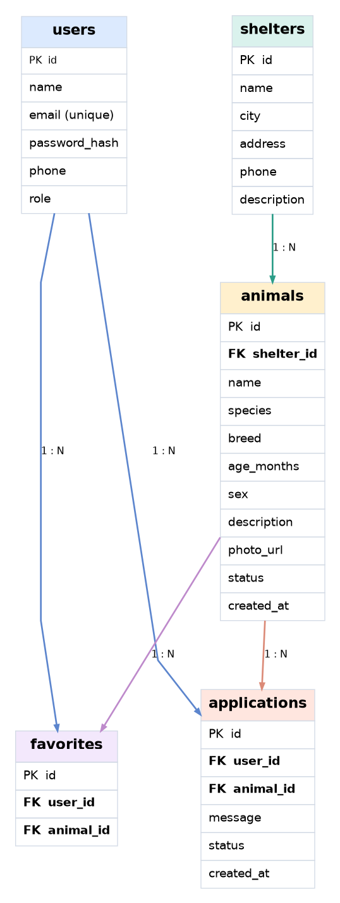

# 🐾 PawHome — допоможемо тваринкам знайти дім

**PawHome** — майбутній сайт для пошуку собачок і котиків із притулків. Люди зможуть обрати тварину, дізнатися про неї більше та подати заявку, щоб забрати її додому.

> **Зараз це документація майбутнього проєкту.** Сам сайт реалізовуватимемо на наступних заняттях.

## 1. Ідея та можливості сайту

| Розділ | Що можна буде робити |
| --- | --- |
| Каталог тварин | Шукати за кличкою або породою, фільтрувати за видом, віком, містом і статусом, сортувати за віком чи датою додавання. |
| Сторінка тварини | Дивитися фото, вік, породу, стать, опис характеру та притулок. |
| Притулки | Переглядати адреси, контакти й тварин конкретного притулку. |
| Профіль | Реєструватися, входити на сайт і редагувати свої дані. |
| Обране | Зберігати тварин, які сподобалися. |
| Заявки | Подавати заявку на прихисток і перевіряти її статус. |
| Керування | Адміністратор зможе працювати з тваринами, притулками й заявками. |
| Про нас | Читати інформацію про PawHome та контакти. |

Без реєстрації доступні каталог, інформація про тварин, притулки та сторінка «Про нас». Для обраного, заявок і профілю потрібно увійти. Змінювати дані тварин і притулків зможе тільки адміністратор.

## 2. REST API

**Базова адреса:** `/api`  
**Формат запитів і відповідей:** JSON (`application/json`).  
`{id}` означає номер запису в адресі, наприклад `/api/animals/12`.

| Метод | Призначення |
| --- | --- |
| `GET` | Отримати дані |
| `POST` | Створити запис або надіслати дані для входу |
| `PATCH` | Змінити окремі поля |
| `DELETE` | Видалити запис |

**Основні статуси:** `200 OK` — успіх; `201 Created` — створено; `204 No Content` — успішно без тіла відповіді; `400 Bad Request` — некоректні дані; `401 Unauthorized` — потрібно увійти; `403 Forbidden` — немає прав; `404 Not Found` — не знайдено; `409 Conflict` — конфлікт даних.

**Формат помилки:** `{"error":"Тварину не знайдено"}`. У прикладах нижче використані умовні дані. Позначка **JSON: немає** означає, що тіло запиту або відповіді відсутнє.

### 2.1. Тварини

#### `GET /api/animals`
Показати каталог тварин. **Доступ:** усі.
- **Запит:** параметри `search` (кличка/порода), `species` (`dog`/`cat`), `city`, `shelter_id`, `age_min`, `age_max` (вік у місяцях), `status` (`available`/`adopted`), `sort` (`newest`/`age_asc`/`age_desc`). Необов'язкові; за замовчуванням `status=available`, `sort=newest`. JSON: немає.
- **Відповідь:** `200 OK`. JSON:

```json
{
  "animals": [
    {
      "id": 12,
      "name": "Луна",
      "species": "dog",
      "age_months": 8,
      "status": "available",
      "shelter_id": 3
    }
  ]
}
```

#### `GET /api/animals/{id}`
Відкрити детальну сторінку тварини. **Доступ:** усі.
- **Запит:** `id` тварини в адресі; JSON: немає.
- **Відповідь:** `200 OK` (якщо тварину не знайдено — `404`). JSON:

```json
{
  "id": 12,
  "name": "Луна",
  "species": "dog",
  "breed": "метис",
  "age_months": 8,
  "sex": "female",
  "description": "Грайлива собака",
  "photo_url": "https://example.com/luna.jpg",
  "status": "available",
  "shelter_id": 3
}
```

#### `POST /api/animals`
Додати тварину. **Доступ:** адміністратор.
- **Запит:** параметрів немає. JSON:

```json
{
  "name": "Луна",
  "species": "dog",
  "breed": "метис",
  "age_months": 8,
  "sex": "female",
  "description": "Грайлива собака",
  "photo_url": "https://example.com/luna.jpg",
  "status": "available",
  "shelter_id": 3
}
```
- **Відповідь:** `201 Created`; JSON: `{"id":12,"name":"Луна","status":"available"}`. Можливі `400`, `401`, `403`, `404`.

#### `PATCH /api/animals/{id}`
Редагувати інформацію про тварину. **Доступ:** адміністратор.
- **Запит:** `id` в адресі; JSON: `{"status":"adopted"}` (передаємо лише змінені поля).
- **Відповідь:** `200 OK`; JSON: `{"id":12,"name":"Луна","status":"adopted"}`. Можливі `400`, `401`, `403`, `404`.

#### `DELETE /api/animals/{id}`
Видалити анкету тварини. **Доступ:** адміністратор.
- **Запит:** `id` в адресі; JSON: немає.
- **Відповідь:** `204 No Content`; JSON: немає. Можливі `401`, `403`, `404`.

### 2.2. Притулки

#### `GET /api/shelters`
Показати список притулків. **Доступ:** усі.
- **Запит:** необов'язковий параметр `city`; JSON: немає.
- **Відповідь:** `200 OK`; JSON: `{"shelters":[{"id":3,"name":"Добрі лапки","city":"Львів"}]}`.

#### `GET /api/shelters/{id}`
Показати контакти й опис притулку. **Доступ:** усі.
- **Запит:** `id` притулку в адресі; JSON: немає.
- **Відповідь:** `200 OK` (можливий `404`). JSON:

```json
{
  "id": 3,
  "name": "Добрі лапки",
  "city": "Львів",
  "address": "вул. Прикладна, 5",
  "phone": "+380000000000",
  "description": "Допомагаємо тваринам"
}
```

#### `GET /api/shelters/{id}/animals`
Показати тварин конкретного притулку. **Доступ:** усі.
- **Запит:** `id` притулку в адресі, необов'язковий `status` (за замовчуванням `available`); JSON: немає.
- **Відповідь:** `200 OK`; JSON: `{"animals":[{"id":12,"name":"Луна","species":"dog","status":"available"}]}`. Можливий `404`.

#### `POST /api/shelters`
Додати притулок. **Доступ:** адміністратор.
- **Запит:** параметрів немає; JSON: `{"name":"Добрі лапки","city":"Львів","address":"вул. Прикладна, 5","phone":"+380000000000","description":"Допомагаємо тваринам"}`.
- **Відповідь:** `201 Created`; JSON: `{"id":3,"name":"Добрі лапки"}`. Можливі `400`, `401`, `403`.

#### `PATCH /api/shelters/{id}`
Змінити контакти або опис притулку. **Доступ:** адміністратор.
- **Запит:** `id` в адресі; JSON: `{"phone":"+380111111111"}`.
- **Відповідь:** `200 OK`; JSON: `{"id":3,"name":"Добрі лапки","phone":"+380111111111"}`. Можливі `400`, `401`, `403`, `404`.

#### `DELETE /api/shelters/{id}`
Видалити притулок, якщо там немає тварин. **Доступ:** адміністратор.
- **Запит:** `id` в адресі; JSON: немає.
- **Відповідь:** `204 No Content`; JSON: немає. Можливі `401`, `403`, `404`, `409` (у притулку ще є тварини).

### 2.3. Реєстрація та профіль

> **TODO:** Реєстрацію й вхід реалізуємо пізніше. Спосіб збереження входу ще потрібно вибрати. Пароль не повертаємо у відповідях і не зберігаємо відкритим текстом.

#### `POST /api/auth/register`
Створити обліковий запис. **Доступ:** усі.
- **Запит:** параметрів немає. JSON:

```json
{
  "name": "Оля",
  "email": "olya@example.com",
  "password": "example-password",
  "phone": "+380000000000"
}
```
- **Відповідь:** `201 Created`; JSON: `{"id":5,"name":"Оля","email":"olya@example.com","role":"user"}`. Можливі `400`, `409` (email уже зайнято).

#### `POST /api/auth/login`
Увійти в обліковий запис. **Доступ:** усі.
- **Запит:** параметрів немає; JSON: `{"email":"olya@example.com","password":"example-password"}`.
- **Відповідь:** `200 OK`; JSON: `{"message":"Вхід успішний","user":{"id":5,"name":"Оля","role":"user"}}`. Можливі `400`, `401`.

#### `POST /api/auth/logout`
Вийти з облікового запису. **Доступ:** користувач після входу.
- **Запит:** параметрів немає; JSON: немає.
- **Відповідь:** `200 OK`; JSON: `{"message":"Вихід успішний"}`. Можливий `401`.

#### `GET /api/users/me`
Отримати власний профіль. **Доступ:** користувач після входу.
- **Запит:** параметрів немає; JSON: немає.
- **Відповідь:** `200 OK`; JSON: `{"id":5,"name":"Оля","email":"olya@example.com","phone":"+380000000000","role":"user"}`. Можливий `401`.

#### `PATCH /api/users/me`
Оновити власні дані. **Доступ:** користувач після входу.
- **Запит:** параметрів немає; JSON: `{"name":"Ольга","phone":"+380111111111"}`.
- **Відповідь:** `200 OK`; JSON: `{"id":5,"name":"Ольга","email":"olya@example.com","phone":"+380111111111","role":"user"}`. Можливі `400`, `401`.

### 2.4. Обране

#### `GET /api/favorites`
Отримати своїх обраних тварин. **Доступ:** користувач після входу.
- **Запит:** параметрів немає; JSON: немає.
- **Відповідь:** `200 OK`; JSON: `{"animals":[{"id":12,"name":"Луна","species":"dog","age_months":8}]}`. Можливий `401`.

#### `POST /api/favorites`
Додати тварину в обране. **Доступ:** користувач після входу.
- **Запит:** параметрів немає; JSON: `{"animal_id":12}`.
- **Відповідь:** `201 Created`; JSON: `{"id":4,"animal_id":12}`. Можливі `400`, `401`, `404`, `409` (уже додано).

#### `DELETE /api/favorites/{animal_id}`
Прибрати тварину зі свого обраного. **Доступ:** користувач після входу.
- **Запит:** `animal_id` в адресі; JSON: немає.
- **Відповідь:** `204 No Content`; JSON: немає. Можливі `401`, `404`.

### 2.5. Заявки на прихисток

Статуси: `pending` — очікує, `approved` — схвалено, `rejected` — відхилено. Після схвалення заявки тварина отримує статус `adopted`.

#### `GET /api/applications`
Показати власні заявки; адміністратору — всі. **Доступ:** після входу.
- **Запит:** параметрів немає; JSON: немає.
- **Відповідь:** `200 OK`; JSON: `{"applications":[{"id":7,"animal_id":12,"status":"pending","created_at":"2026-10-13T12:30:00Z"}]}`. Можливий `401`.

#### `GET /api/applications/{id}`
Відкрити заявку. **Доступ:** власник заявки або адміністратор.
- **Запит:** `id` заявки в адресі; JSON: немає.
- **Відповідь:** `200 OK`; JSON: `{"id":7,"user_id":5,"animal_id":12,"message":"Хочу забрати Луну","status":"pending","created_at":"2026-10-13T12:30:00Z"}`. Можливі `401`, `403`, `404`.

#### `POST /api/applications`
Подати заявку на тварину, яка шукає дім. **Доступ:** користувач після входу.
- **Запит:** параметрів немає; користувач визначається після входу. JSON:

```json
{
  "animal_id": 12,
  "message": "Хочу забрати Луну"
}
```
- **Відповідь:** `201 Created`; JSON: `{"id":7,"user_id":5,"animal_id":12,"status":"pending"}`. Можливі `400`, `401`, `404`, `409` (тварина недоступна).

#### `PATCH /api/applications/{id}`
Схвалити або відхилити заявку. **Доступ:** адміністратор.
- **Запит:** `id` заявки в адресі; JSON: `{"status":"approved"}`.
- **Відповідь:** `200 OK`; JSON: `{"id":7,"animal_id":12,"status":"approved"}`. Можливі `400`, `401`, `403`, `404`, `409`.

#### `DELETE /api/applications/{id}`
Відкликати свою заявку, доки її не розглянули. **Доступ:** власник заявки.
- **Запит:** `id` заявки в адресі; JSON: немає.
- **Відповідь:** `204 No Content`; JSON: немає. Можливі `401`, `403`, `404`, `409` (заявку вже розглянуто).

> **TODO:** Уточнити, як обробляти інші заявки, коли одну заявку на тварину схвалено.

### 2.6. Про нас

#### `GET /api/about`
Показати інформацію та контакти PawHome. **Доступ:** усі.
- **Запит:** параметрів немає; JSON: немає.
- **Відповідь:** `200 OK`; JSON: `{"title":"Про PawHome","description":"Допомагаємо тваринам знайти дім","email":"hello@pawhome.example"}`.

## 3. Схема бази даних



| Таблиця | Поля | Для чого |
| --- | --- | --- |
| `users` | `id` (PK), `name`, `email`, `password_hash`, `phone`, `role` | Користувачі та адміністратори. |
| `shelters` | `id` (PK), `name`, `city`, `address`, `phone`, `description` | Інформація про притулки. |
| `animals` | `id` (PK), `shelter_id` (FK), `name`, `species`, `breed`, `age_months`, `sex`, `description`, `photo_url`, `status`, `created_at` | Тварини в притулках. |
| `favorites` | `id` (PK), `user_id` (FK), `animal_id` (FK) | Обране користувачів. |
| `applications` | `id` (PK), `user_id` (FK), `animal_id` (FK), `message`, `status`, `created_at` | Заявки на прихисток. |

**PK** — унікальний номер запису; **FK** — поле, яке посилається на іншу таблицю. Один притулок має багато тварин; користувач може мати багато обраних тварин і заявок; на одну тварину можуть надходити заявки від різних людей. Email користувача та пара `user_id` + `animal_id` в обраному не повинні повторюватися.

## 4. План розробки

- [x] Обрати тему й описати функціонал сайту.
- [x] Спланувати REST API та JSON-запити й відповіді.
- [x] Намалювати схему бази даних.
- [ ] Реалізувати сторінки й роботу з тваринами та притулками.
- [ ] Додати реєстрацію, профіль, обране й заявки.
- [ ] Написати тести та вдосконалити сайт.

## 5. Корисні джерела

- [GitHub Docs — оформлення Markdown](https://docs.github.com/en/get-started/writing-on-github/getting-started-with-writing-and-formatting-on-github/basic-writing-and-formatting-syntax)
- [Make a README](https://www.makeareadme.com/)
- [REST API Design Tutorial](https://restfulapi.net/rest-api-design-tutorial-with-example/)
- [Stack Overflow Blog — REST API best practices](https://stackoverflow.blog/2020/03/02/best-practices-for-rest-api-design/)

---

*PawHome — допомагаємо тваринам знайти дім! 🐾*
